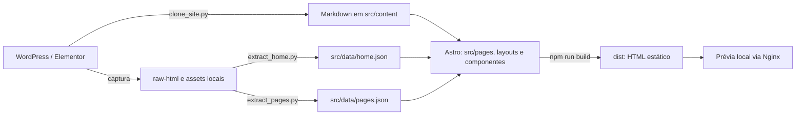

# Handover — site-vertigo

Documento de entrada para pessoas e agentes Claude que vão entender ou continuar este projeto. Foi escrito a partir do estado local do repositório em 19/11/2026; confirme configurações e dados que possam ter mudado antes de publicar.

## Identificação e situação

- Projeto: migração do site institucional `vertigo.com.br` de WordPress + Elementor para páginas HTML estáticas geradas por Astro.
- Repositório local: `/Users/vcarva/workdir/vertigo/site-vertigo`.
- Remoto Git configurado como `origin`: <https://gitlab.vertigo-devops.com/ai-studio/poc/demo-site-estatico-vertigo.git>. A configuração local do Mac reescreve essa URL para SSH durante fetch/push (`git remote -v` mostra `git@gitlab.vertigo-devops.com:...`).
- Branch local observado: `main`. O remoto foi configurado neste handover; não foi feito push nem conferida a sincronização com o GitLab.
- Produção ainda não está definida. A configuração Docker documenta desenvolvimento e uma prévia local do build.

## O que o projeto faz

O projeto recria o site público sem depender de WordPress em tempo de execução. O Astro lê conteúdo Markdown, dados JSON e assets locais, gera uma árvore de arquivos HTML em `dist/` e preserva as URLs do WordPress sempre que elas estão representadas no mapa de rotas.

O código tem duas partes que trabalham juntas:

1. **Dump e normalização do conteúdo:** `scripts/clone_site.py` consulta a API pública do WordPress e páginas do site, transforma páginas, posts e cases em Markdown, salva capturas HTML e baixa assets.
2. **Tema e geração estática:** `src/` define layouts, componentes, estilos e rotas Astro. `npm run build` produz o site em `dist/`.



## Conceitos e fontes de verdade

| Caminho | Papel | Observação |
|---|---|---|
| `src/content/pages/` | Conteúdo das páginas em Markdown | `originalUrl` no frontmatter determina a URL pública. |
| `src/content/blog/` | Posts em Markdown | Posts publicados também ficam na raiz, como no WordPress. |
| `src/content/cases/` | Cases e materiais | A listagem usa dados locais e pode apontar para `materiais.vertigo.com.br`. |
| `src/content.config.ts` | Coleções Astro e schema de frontmatter | O schema é permissivo porque o dump adiciona campos. |
| `data/url-map.json` | Mapa de URLs e IDs do WordPress | Usado pela checagem de rotas e pelo redirecionamento de `?p=` / `?page_id=` na prévia Docker. |
| `data/*.json` | Taxonomias, mapa e manifestos do dump | Não confundir esses dados de origem com os JSON específicos da camada visual em `src/data/`. |
| `raw-html/` | Capturas HTML de páginas do WordPress | Entrada de scripts de extração; não é copiada para a imagem de prévia. |
| `src/data/home.json` | Dados estruturados de seções da home | Gerado de `raw-html/index.html` por `tools/extract_home.py`. |
| `src/data/pages.json` | Metadados por página, como hero e formulário | Gerado por `tools/extract_pages.py`; o script também pode baixar CSS/imagens do site. |
| `public/wp-content/uploads/` | Imagens e arquivos usados pelo conteúdo | Assets locais preservam os caminhos do WordPress. |
| `src/pages/`, `src/layouts/`, `src/components/`, `src/styles/` | Implementação do tema | Alterações visuais e de comportamento ficam principalmente aqui. |
| `dist/` | Saída compilada | Gerada pelo build; não é fonte de edição. Está no `.gitignore`. |

O cabeçalho `slug` do Markdown não determina a rota. A função `pathOf()` em `src/lib/routes.ts` prioriza o caminho de `originalUrl`; por isso preserve esse campo ao editar ou importar conteúdo. O `id` do conteúdo Astro vem do nome do arquivo, definido em `src/content.config.ts`.

## Rotas e renderização

- Rotas com implementação própria: `/`, `/blog/`, `/materiais/`, `/solucoes/` e `/contato/`.
- A página inicial é composta por componentes em `src/components/home/`; `src/content/pages/index.md` fornece metadados, e `src/data/home.json` fornece os dados das seções.
- O catch-all `src/pages/[...slug].astro` atende páginas e posts. Posts usam `PostLayout`; páginas usam `PageLayout`.
- Cases usam `src/pages/cases/[slug].astro`.
- `trailingSlash: "always"` e `build.format: "directory"` geram URLs como `/exemplo/` em `dist/exemplo/index.html`.
- Entradas com `status` diferente de `publish` são filtradas. O catch-all falha o build quando duas entradas publicadas tentam ocupar a mesma URL.
- O índice do blog pagina em grupos de 9 posts. A busca do blog tem endpoint local em `src/pages/blog/busca.json.ts`.

## Integrações e comportamento externo

- Formulários HubSpot: componente `src/components/HubSpotForm.astro`; IDs por página ficam em `src/data/pages.json` e dados globais em `src/data/site.ts`.
- Google Tag Manager: incluído no `BaseLayout` apenas em build de produção (`import.meta.env.PROD`).
- Botão de WhatsApp: `src/components/WhatsAppButton.astro`.
- Alguns links de materiais e cases continuam levando a `materiais.vertigo.com.br`.
- A prévia Nginx reproduz alguns comportamentos de compatibilidade do WordPress. Consulte `docker/README.md` e `docker/nginx.conf` antes de mudar redirects.

## Como começar

### Opção recomendada: Docker

Requer Docker Desktop com Docker Compose. Na raiz do projeto:

```bash
docker compose up -d dev
```

Abra <http://localhost:4322>. O código é montado no container e o Astro usa polling para detectar alterações no volume do Docker Desktop. `node_modules` e `.astro/` ficam em volumes Docker, separados dos binários do macOS.

Para acompanhar logs e parar o serviço:

```bash
docker compose logs -f dev
docker compose down
```

Para gerar o site e servir a prévia estática por Nginx:

```bash
docker compose --profile preview up -d --build preview
```

Abra <http://localhost:8081>. Esse alvo executa `npm run build` e `npm run check:routes` durante a construção da imagem. Se a imagem já existir, `--build` refaz o build. Para encerrar, use `docker compose down`.

As portas podem ser substituídas por `DEV_PORT` e `PREVIEW_PORT` no ambiente ou em `.env`. O `.env` é ignorado pelo Git; não coloque segredos no handover.

Para executar ferramentas Python no container:

```bash
docker compose run --rm tools python tools/extract_home.py
docker compose run --rm tools python tools/extract_pages.py
```

`tools` monta o repositório e escreve os arquivos gerados na árvore local. Veja `docker/README.md` para detalhes de polling, cache e dependências.

### Execução no host

Com Node.js compatível com o projeto:

```bash
npm install
npm run dev
```

O servidor local abre em <http://localhost:4321>. Os scripts em `package.json` são a referência para os comandos disponíveis:

| Comando | Efeito |
|---|---|
| `npm run dev` | Servidor Astro de desenvolvimento. |
| `npm run build` | Gera `dist/`. |
| `npm run preview` | Serve localmente a saída Astro já gerada. |
| `npm run check:routes` | Confere se todos os caminhos de `data/url-map.json` têm arquivo em `dist/`. Rode após o build. |
| `npm run extract` | Executa os dois extratores de `raw-html/` usando `.venv`. |

O `.venv` não é versionado. Para ferramentas de dump/extração no host, instale `docker/requirements.txt` em um ambiente virtual próprio; Docker evita depender da versão Python instalada no Mac.

## Atualização do conteúdo

O dump é uma operação de coleta que acessa `vertigo.com.br` e a API WordPress; não é necessário para iniciar o tema com o conteúdo que já está no checkout. Execute somente quando a intenção for atualizar o snapshot:

```bash
docker compose run --rm tools python scripts/clone_site.py
```

Sem argumentos, o script coleta `pages`, `cases` e `posts`; também aceita uma lista explícita, por exemplo `pages posts`. Ele atualiza Markdown, capturas, assets, manifestos e mapa de URLs. Erros individuais de conteúdo/assets podem ser registrados e a coleta pode continuar, então revise os logs e o diff antes de considerar o dump completo.

Após atualizar o dump, regenere os dados derivados que alimentam componentes Astro:

```bash
docker compose run --rm tools python tools/extract_home.py
docker compose run --rm tools python tools/extract_pages.py
```

`extract_pages.py` pode fazer requisições HTTP para buscar CSS e imagens de hero. Em seguida, revise as alterações de conteúdo/dados/assets e gere o site:

```bash
docker compose --profile preview up -d --build preview
```

Antes de commitar, confira `git status` e `git diff`, especialmente `data/url-map.json`, `src/content/`, `src/data/` e `public/`. Como `url-map.json` acumula URLs antigas ao mesclar a coleta nova, verifique entradas removidas ou redirecionadas quando uma página mudar no WordPress.

## Limites conhecidos

O próprio projeto registra os seguintes comportamentos ainda incompletos:

- Categorias e tags do WordPress não têm arquivos equivalentes no tema; esses caminhos retornam 404 na prévia.
- `/wp-json/`, `/sitemap_index.xml` e `/robots.txt` não estão reproduzidos pela prévia.
- A versão em inglês, banner de cookies, popup de inscrição e filtros de categoria/tag do blog estão fora do escopo documentado no `README.md`.
- `/carreiras/`, `/ai-journey/` e `/parceiros/` usam layout genérico; `/sobre/` tem conteúdo de exemplo indicado pelo README.
- Docker está definido para desenvolvimento e prévia local, não para deploy de produção.
- `docker/README.md` estima custo de CPU do polling no Docker Desktop. `DEV_POLLING=0` desliga polling, mas também interrompe hot reload.

Confirme cada limite no código atual antes de iniciar a implementação; este documento descreve o estado observado e pode ficar desatualizado.

## Referências de código

- `README.md`: comandos Astro, organização de pastas, rotas e escopo conhecido.
- `docker/README.md`: fluxos de Docker e diferenças entre a prévia e o WordPress.
- `compose.yaml`: serviços `dev`, `preview` e `tools`, portas e volumes.
- `docker/Dockerfile`: etapas `dev`, `build` e `preview`.
- `scripts/clone_site.py`: coleta e conversão do WordPress.
- `tools/extract_home.py` e `tools/extract_pages.py`: dados derivados de páginas Elementor.
- `src/lib/routes.ts`: resolução de URLs e utilitários para blog.
- `src/content.config.ts`: coleções e schema de conteúdo.

## Para a próxima pessoa ou agente Claude

1. Leia este handover, `README.md` e `docker/README.md`.
2. Confirme `git status --short --branch` e `git remote -v`; confira a branch remota no GitLab antes de publicar alterações.
3. Para trabalho visual/comportamental, comece em `src/pages/`, `src/components/`, `src/layouts/` ou `src/styles/` e siga os dados que cada arquivo consome.
4. Para mudança de conteúdo, respeite `originalUrl`, frontmatter e a separação entre arquivos-fonte e JSON derivado.
5. Use `npm run build` seguido de `npm run check:routes` quando quiser validar uma mudança de geração de páginas. A construção do perfil Docker `preview` já executa ambos.
6. Registre qualquer decisão de deploy, sincronização com WordPress ou mudança de URL que não esteja documentada aqui.

Não assuma que o conteúdo capturado é idêntico ao site WordPress atual nem que o remoto GitLab já recebeu os commits locais. Confirme esses estados no início do trabalho.
